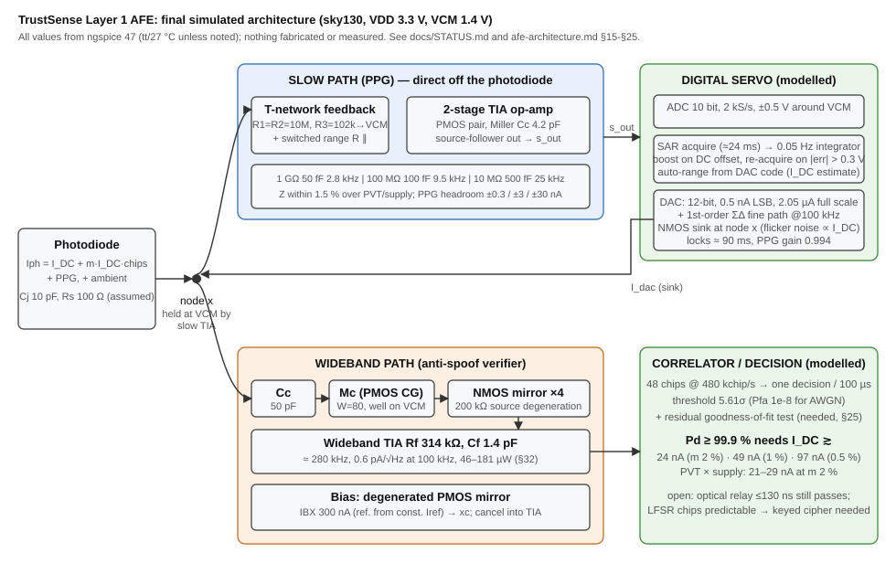

# TrustSense Layer 1 AFE: status (2026-10-17, audited §33)

One-page summary of where the design stands. **For a plain-language version see [`reports/`](reports/README.md).** Details, derivations and every
failed attempt are in [`afe-architecture.md`](afe-architecture.md) (§ numbers
below) and [`TIA-DESIGN.md`](TIA-DESIGN.md). Everything here is **simulated in
ngspice 47 with the sky130 models, not built or measured**.



## Current design (what the numbers below are for)

```
                     Cj (10 pF assumed)
 photodiode ──► x ──────────────────────────────► slow TIA ► PPG
                │       (T-network 1 GΩ, 2.8 kHz,  ▲
                │        NMOS sink cancels I_DC) ──┘ digital-assisted servo
                │
                └─ Cc 50 pF ─► common-gate PMOS Mc ─► NMOS mirror (4x, degenerated)
                                                       ─► wideband TIA 314 kΩ ─► correlator
   bias: degenerated PMOS mirror, IBX = 300 nA (also cancels at the TIA input)
```

* **Slow path (PPG):** photodiode node straight into a two-stage TIA with a
  poly **T-network** feedback (R1 = R2 = 10 MΩ, R3 = 102 kΩ, Cf 50 fF) =
  0.99 GΩ, ~2.8 kHz. DC photocurrent is cancelled by an NMOS sink driven by a
  **digital-assisted servo** (modelled as a behavioral integrator + real
  device). (§15, §20)
* **Wideband path (anti-spoof verifier):** AC-coupled (50 pF) common-gate PMOS,
  4x NMOS current mirror with 200 kΩ source degeneration, 314 kΩ TIA. Bias
  from a 3 MΩ-degenerated PMOS mirror. (§15, §17, §18)
* Code: 48 chips, 480 kchip/s, one decision per 100 µs, bipolar ±m·I_DC.

## Headline results

| item | result | where |
|---|---|---|
| Slow-path gain | 0.986–0.997 GΩ at all PVT and ±10 % supply points; **3 ranges 1 GΩ / 100 MΩ / 10 MΩ**, auto-selected, PPG gain 0.9986–0.9989 from 5 nA to 1 µA | §20, §22, §24 |
| Slow-path noise (0.5–100 Hz, I_DC = 100 nA) | 7.4–9.5 pA RMS | §14, §20 |
| Wideband bandwidth / gain | **−3 dB band 1.8–63 kHz** at the final IBX = 300 nA (gain at 480 kHz = 13 % of peak; target 480 kHz not met; ≈ 280 kHz only at IBX = 1 µA), 314 kΩ; costs ≈ 1.2 dB vs a matched chip rate | §21, §38 |
| Wideband input noise | ≈ 0.6 pA/√Hz at 100 kHz (hand budget was 0.24) | §17 |
| **Min I_DC for Pd ≥ 99.9 % at Pfa = 1e-8** | **24 nA (m = 2 %), 49 nA (1 %), 97 nA (0.5 %)** | §18 |
| Same across PVT (m = 2 %) | 21–29 nA | §20, §29 |
| Bias current over PVT / supply | exactly 300 nA with the supply-independent reference (241–363 nA with a resistor reference; the reference is ideal here) | §19, §22, §28 |
| **Supply ±10 % × PVT (VCM 1.4 V)** | slow Z within 1.5 % of 1 GΩ; wide min I_DC 20.8–29.2 nA | §22 |
| Stability (§32) | slow-loop PM 65–80°, wideband-loop PM 62–71° (GM 13–21 dB) at the low-power bias, corners checked; baseline slow loop 48° was weakest | §32 |
| **Analog power** | 241–299 µW at baseline bias; **61–74 µW with a 4x lower op-amp bias (Cf 150 fF/500 fF/1.5 pF), detection reach 2–4 % worse**; digital excluded | §32 |
| **Slow-path noise vs cancel device** | the cancel device is 85–95 % of the slow-path noise; degenerating it to ≈ 0.3 V drop cuts it 4.7x at 100 nA (8.4 → 1.8 pA) and 8x at 1 µA (78 → 9.5 pA) | §33, §34 |
| Chip-rate trade | 240→480 kchip/s costs only 12 %; T_int 200 µs cuts need by 37 % | §21 |

The detection numbers were re-verified on the final front end (§30, identical within 0.5 %).

Detection is evaluated by a Monte Carlo of random 48-chip codes through the
simulated channel (`simulation/detect/coherent_mc.py`), noise-only correlator
output Gaussian to 4σ. **Pfa = 1e-8 relies on the Gaussian-noise assumption**
(cannot be verified empirically).

**Common-mode level is VCM = 1.4 V, not 1.65 V:** at VDD = 2.97 V the source-follower
outputs could not reach 1.65 V (min I_DC rose to 82–135 nA). Fixed in §22.

## What the original brief / early docs claimed that is now wrong

* "1 kV/pA", noise < 100 µV, rise time < 100 ns at 1 GΩ: unreachable (§0 of
  TIA-DESIGN; rise time is ~0.35/BW ≈ 130 µs).
* The hand-derived wideband budget (236 fA/√Hz, pass at all I_DC ≥ 10 nA for
  m = 2 %): the simulated front end is ~2.6x noisier and needs **≥ 24 nA** at
  m = 2 % (≥ 97 nA at m = 0.5 %). 10 nA / 2 % reaches only ≈ 11.5 dB vs the
  18.8 dB required.
* PMOS pseudo-resistor "1 GΩ": measures 0.8 MΩ – 120 GΩ over PVT. Replaced.
* "Regulated cascode" input: the booster never regulated (gate pinned at 0 V);
  it is a plain common-gate PMOS and the booster adds noise (§17).
* A shared buffer / mirror in the slow path: costs 29x in slow-path noise, so
  the slow path now connects directly to the photodiode (§14, §15).
* §3–§6 of afe-architecture.md (Rf_wide/N tables, SNR tables) are the
  *pre-simulation* hand analysis; keep for the derivations, not the numbers.

## Added after the status above (2026-10-17; afe-architecture.md §39–§48, `simulation/twin/`, `simulation/rtl/`)

* **Digital twin** (`simulation/twin/`): end-to-end model (servo path + fast verifier + Trivium chips + attacks), validated against the SPICE studies (detection SNR within 1.2 %, range choice, lock 24.5 ms, PPG gain and noise).
* **Digital blocks as RTL** (`simulation/rtl/`, Amaranth + yosys): Trivium (301 FF / 522 gates), fast-path verifier (422 FF / 4 754 gates, bit-exact vs the fixed-point model), servo with auto-range (126 FF / 1 934 gates; closed-loop lock 25 ms). §44.
* **Chip generator = Trivium; key/IV protocol specified** (§40, §46): replay and wrong-key frames are rejected by the residual test; an IV must never repeat.
* **Relay attack is not defendable inside Layer 1** (§40): needs module-level measures; state it in the threat model.
* **Area reduction** (§42): one T-network per range instead of the 111 MΩ parallel resistor; Cc 25 pF would cost 11 % in reach.
* **Cancel converter:** gate-voltage DAC + ΣΔ with switched source resistor (§41, §45): a 100 kΩ output adds < 0.1 pA, ripple < 0.06 mV at the slow output; splitting into unit cells changes nothing (§39).
* **Fast-path ADC:** 4 samples/chip, 6 bits at 300 µV LSB with a programmable-gain preamp (§41, §44).
* **Ambient interference (new limitation, §47):** fixed residual thresholds fail at 1 % flicker; adaptive thresholds from dark frames work up to ≈ 10 % (mains) / 1 % (kHz lamp PWM) of I_DC; adaptation logic not built.
* **Budget from synthesis:** ≈ 161 000 µm² (≈ 9 Tiny-Tapeout 1×1 tiles, ≈ 12 with routing margin); power ≈ 92–105 µW vs the 87 µW goal (not met with the residual test) (§44).
* **Flicker model** (§48): extracted 3.7×10⁻¹⁰ V²·µm² (NMOS), still unverified against silicon.

## Open items and risks (most important first)

1. **Spec miss at low photocurrent.** Below ≈ 24 nA (2 % modulation) the
   verifier cannot reach Pd 99.9 % at Pfa 1e-8; low perfusion / high melanin
   patients are exactly where I_DC is lowest. Mitigations seen: longer
   integration (T_int 200 µs: −37 %), adaptive wavelength (§7).
2. **Digital servo: sized and simulated, not built (§23).** 10-bit ADC @ 2 kS/s,
   12-bit 0.5 nA DAC + sigma-delta fine path, SAR acquisition (≈ 24 ms) then a
   0.05 Hz integrator; locks in ≈ 90 ms from power-up, adds no measurable noise,
   PPG gain 0.994; 1 GΩ clipping PPG above ≈ 150–250 pA is solved by 3 switchable
   ranges with auto-ranging (§24, real switches §31). Now also as RTL (§44) and with a gate-voltage DAC design (§41, §45). Still open: the DAC string/switch and ADC
   *circuits* at transistor level, range-switch glitches of the extra resistors, and silicon confirmation of the cancel-device noise (§48).
3. **Security is weaker than the early docs claimed (§25).** A correlation-only
   detector accepts a blind random injection 16 % of the time (50 % when loud);
   a residual (goodness-of-fit) test fixes the blind case at 0.1 %-pt cost in
   legitimate Pd, but attackers with ≥ 90 % of the chips pass 8–29 %, and a
   **real-time optical relay with ≤ 130 ns latency passes 97–100 %**. A plain
   LFSR chip generator is fully predictable after 64 observed chips (133 µs).
   Now: Trivium keyed generator and a key/IV protocol (§40, §46); relay attacks are out of scope for Layer 1 (needs module-level measures). Still needs a cryptographer's review, the TRNG/OTP circuits, and power-analysis resistance.
4. **Supply rejection: fixed (§27–§29).** Two body-effect paths (the wideband input PMOS Mc and
   the op-amp input pairs, wells tied to VDD) and resistor-from-VDD bias references were the
   cause. Wells moved to quiet nodes / their own source and bias references made supply-
   independent: supply-equivalent input current down 24–13000x (slow 10 Hz 575 → 1.1 pA per
   V/√Hz; wide 100 kHz 1.06 µA → 1.8 nA). Performance across PVT × supply unchanged
   (min I_DC 21–29 nA). The references are ideal sources in the simulation.
5. **Not simulated:** random mismatch Monte Carlo (worst-case offsets only, §26: ≤ 1 %
   effect), ambient light
   (I_amb), photodiode model beyond Cj = 10 pF + Rs = 100 Ω, layout parasitics, any
   place-and-route (the area figure ≈ 161 000 µm² is a synthesis-based estimate, §44) and ambient interference above 10 % / 1 % (§47).
6. Poly resistors are ideal in SPICE; absolute tolerance (±20 %) moves the slow
   gain proportionally (a calibratable constant).
7. Ideal elements still in the netlist: the digital servo, Rref/Rs/R1–R3, the
   wide TIA's ideal Rf (314 kΩ).
8. `hardware/afe/tia.sch` is the old single-TIA drawing, marked superseded;
   there is no xschem schematic of the final design. A block diagram with the
   simulated values is in [`architecture.svg`](architecture.svg).

## Reproduce

```
export NGSPICE=<path>/ngspice_con.exe  SKY130_FD_PR=<skywater-pdk-libs-sky130_fd_pr checkout>
bash simulation/spice/run-tia-sim.sh                         # builds sky130_min.lib, slow TIA alone
python simulation/spice/tools/gen_afe_direct.py              # writes afe_direct.spice
TAG=k_ python simulation/spice/tools/corner_run.py NAME tt 27 100n tnet=1 t1=10Meg t3=102k tcf=50f
TAG=o_ FINAL=1 python simulation/spice/tools/make_chan_opt.py 100n 0.552389   # final-design channel (6-digit Msv gate V from corner_run)
python simulation/detect/coherent_mc.py simulation/spice/results_final    # Pd / Pfa Monte Carlo
python simulation/detect/test_mc_analytic.py                              # engine check vs closed form (§33)
python simulation/detect/chip_rate_sweep.py                               # §21
```
(`TAG` prefixes scratch files so runs can go in parallel; results live in
`simulation/spice/results*/`.)

**Audit (§33):** the detection engine matches a closed-form check to 0.1 %; the original runner reproduces its numbers; two documentation errors (supply-noise budgets, an unproven tolerance explanation) and the stale lists above were corrected.
